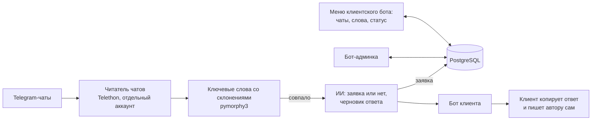

# Telegram Lead Hunter

[Русский](#русский) · [English](#english)

## Русский

Сервис читает Telegram-чаты через отдельный аккаунт, находит сообщения-заявки по ключевым словам с учётом склонений,
просит ИИ решить, правда ли это заказ, и присылает клиенту готовый ответ через его собственного бота. Клиентов может
быть много: у каждого свой бот, свои чаты и слова, пробный период и подписка, а новые чаты проходят модерацию.
Данные хранятся в PostgreSQL.

### Пример уведомления

> 🔔 **Новый лид!**
>
> **Чат:** Пример-чат
> **От:** пользователь чата
> **По словам:** фотограф
>
> **Запрос:** _Ищу фотографа на семейную съёмку в субботу, кто может?_
>
> 🤖 **Ответ-заготовка (копировать):** `Здравствуйте! В субботу свободен. Могу прислать примеры работ и назвать стоимость, напишите, где и сколько человек будет на съёмке.`
>
> ПЕРЕЙТИ К СООБЩЕНИЮ →

Бот ничего не пишет в чаты: ответ клиент копирует и отправляет сам.

### Что умеет

- Читает чаты через один аккаунт Telegram (Telethon) и раздаёт заявки всем клиентам, подписанным на чат.
- Подбирает ключевые слова и фразы с учётом склонений (pymorphy3): ключ «фотограф» найдёт «фотографа», «с фотографом»
  и «фотографов». Во фразе должны встретиться все слова, порядок не важен.
- ИИ (DeepSeek или любой OpenAI-совместимый API) решает, заявка ли это, и пишет короткий черновик ответа. Что считать
  заявкой, задаёт промпт вашей ниши.
- У каждого клиента свой бот (токен от @BotFather), свои чаты и ключевые слова. Новому клиенту копируется дефолтный
  набор ниши.
- Бот-админка: клиенты, пробный период (7 дней) и продление подписки, модерация запросов на новые чаты (аккаунт-читатель
  вступает в чат после одобрения), промпт ниши, дефолтный набор, общий выключатель поиска, статистика.
- В последние сутки перед концом доступа клиент получает предупреждение.
- Клиентские боты работают через long polling: свой домен и HTTPS не нужны. Вебхуки остались необязательным режимом.

### Как устроено



Python 3.12, aiogram 3 (боты), Telethon (чтение чатов), pymorphy3 (склонения), asyncpg и PostgreSQL 16, клиент `openai`
(для DeepSeek), Docker Compose.

| Файл | Что внутри |
|---|---|
| `main.py` | запуск четырёх задач: бот-админка, клиентские боты, читатель чатов, предупреждения об окончании доступа |
| `userbot.py` | чтение чатов (Telethon), подбор слов, вызов ИИ, отправка заявки клиенту, вступление в чаты |
| `lead_filters.py` | подбор слов со склонениями и фильтры без сети и Telegram (их проверяют тесты) |
| `admin_bot.py`, `client_bot.py` | меню и команды бота-админки и клиентского бота |
| `client_bots.py` | запуск ботов клиентов: long polling или вебхуки |
| `database.py`, `migrations/` | работа с PostgreSQL; миграции применяются при старте, каждая один раз |
| `gen_session.py` | создание сессии Telethon для аккаунта-читателя |

### Запуск

Понадобятся:
- Docker с Compose v2 и git;
- отдельный Telegram-аккаунт для чтения чатов и его `TELEGRAM_API_ID` с `TELEGRAM_API_HASH` на https://my.telegram.org
  (API development tools);
- бот для админки от @BotFather и ваш Telegram id (например, у @userinfobot);
- ключ DeepSeek API (или другого OpenAI-совместимого).

```bash
git clone https://github.com/olshanskiyad/telegram-lead-hunter.git
cd telegram-lead-hunter
cp .env.example .env        # заполнить: ключи, токен админ-бота, ADMIN_IDS, POSTGRES_PASSWORD
docker compose run --rm --no-deps app python gen_session.py   # один раз: телефон и код из Telegram
docker compose up -d --build
docker compose logs -f app  # убедиться, что всё запустилось
```

Миграции применяются сами при каждом запуске: новые файлы из `migrations/` выполняются один раз, список применённых
лежит в таблице `schema_migrations`. Пока сессии нет, приложение всё равно стартует (боты работают, чтение чатов выключено),
а после создания сессии нужен `docker compose restart app`.

**Первая настройка (в боте-админке, команда /start):**

1. «Промпт ниши»: замените пример (услуги фотографа) на описание вашей ниши. Промпт должен объяснять ИИ, что считать
   заявкой, просить короткий готовый ответ и для всего остального отвечать ровно `[НЕ ЛИД]`: этот маркер фильтрует
   лишнее.
2. «Дефолтный набор»: добавьте чаты и ключевые слова. Чат указывается ссылкой `t.me/...` или @username: аккаунт-читатель
   вступит в него сам. По числовому id он в чат не вступает, а только находит тот, где уже состоит (например, вы
   вступили вручную). Всё это получит каждый новый клиент.
3. Подключите клиента. Клиент создаёт своего бота у @BotFather, вы добавляете его командой
   `/add_client <telegram_id> <токен_бота> [имя]` (или, при `SELF_REGISTRATION=true`, клиент сам присылает токен боту-админке). Затем клиент
   открывает своего бота и нажимает /start (без этого Telegram не даст боту написать клиенту).
4. Продление и отключение: `/extend <telegram_id> <дни>`, `/deactivate <telegram_id>`, список: `/list_clients`.

Если сервис нужен только вам, зарегистрируйте себя клиентом: создайте второго бота и пришлите его токен боту-админке
(администраторам из `ADMIN_IDS` это разрешено всегда). Затем продлите себе доступ командой `/extend <ваш_id> 3650`:
иначе пробный период закончится через 7 дней.

Клиент в своём боте добавляет чаты (ссылка `t.me/...` или @username: запрос уходит вам на одобрение) и ключевые слова
(в начальной форме, через запятую или с новой строки).

Обновление: `git pull && docker compose up -d --build`. Чтобы пересоздать сессию Telethon, сначала остановите сервис
(`docker compose stop app`), затем запустите `gen_session.py` и снова `docker compose up -d`.

Не используйте `docker compose down -v`: ключ `-v` удаляет тома, то есть базу и сессию. Резервная копия базы:
`docker compose exec -T postgres pg_dump -U <POSTGRES_USER> <POSTGRES_DB> > ../leadhunter-backup.sql` (файл кладите
за пределы папки проекта, чтобы он не попал в образ и в git; в дампе токены клиентских ботов и тексты сообщений,
храните его закрыто).

Без Docker: Python 3.12, свой PostgreSQL, `pip install -r requirements.txt`, в `.env` добавьте `DATABASE_URL`, затем
`python gen_session.py` и `python main.py`.

### Настройки

Все настройки в `.env`, описание каждой переменной в [.env.example](.env.example). Главные:

| Переменная | Что задаёт |
|---|---|
| `TELEGRAM_API_ID`, `TELEGRAM_API_HASH` | доступ к Telegram API для аккаунта-читателя |
| `ADMIN_BOT_TOKEN`, `ADMIN_IDS` | бот-админка и кто может им управлять (id через запятую) |
| `ADMIN_CONTACT` | контакт, который клиенты видят в справке и при окончании доступа |
| `DEEPSEEK_API_KEY`, `DEEPSEEK_BASE_URL`, `DEEPSEEK_MODEL` | ИИ: ключ, адрес API и модель |
| `POSTGRES_USER`, `POSTGRES_PASSWORD`, `POSTGRES_DB` | база в Docker Compose (пароль обязателен) |
| `DATABASE_URL` | адрес базы при запуске без Docker Compose |
| `SESSION_DIR`, `SESSION_BASE64` | где лежит сессия Telethon; или она строкой base64 |
| `WEBHOOK_HOST`, `WEBHOOK_PORT`, `CERT_PATH`, `KEY_PATH` | необязательный режим вебхуков |

Свои правки: общая справка клиента в `client_instructions.html` (формат Telegram HTML, `{admin_contact}` подставляется
из `ADMIN_CONTACT`), длительность пробного периода (7 дней) в `Database.add_client` в `database.py`. У клиента может быть
собственный промпт (поле `clients.custom_prompt`) и собственная справка в Telegram HTML (поле `clients.custom_help`);
оба правятся SQL-запросом: `docker compose exec postgres psql -U <POSTGRES_USER> <POSTGRES_DB>`.

### Режим вебхуков (необязательно)

По умолчанию клиентские боты сами опрашивают Telegram (long polling), поэтому ничего публиковать не нужно. Вебхуки
нужны редко. Для них требуется публичный адрес с HTTPS на порту 443, 80, 88 или 8443:

```bash
mkdir -p certs
openssl req -newkey rsa:2048 -sha256 -nodes -keyout certs/webhook_key.pem -x509 -days 3650 \
  -out certs/webhook_cert.pem -subj "/CN=ВАШ_ДОМЕН_ИЛИ_IP"
# в .env: WEBHOOK_HOST=ВАШ_ДОМЕН_ИЛИ_IP  и  WEBHOOK_PORT=8443
docker compose -f docker-compose.yml -f docker-compose.webhook.yml up -d --build
```

Так создаётся бесплатный самоподписанный сертификат (CN должен совпадать с `WEBHOOK_HOST`): приложение само передаёт
его Telegram при настройке вебхука. Брандмауэр должен пропускать выбранный порт. Чтобы вернуться на long polling,
очистите `WEBHOOK_HOST` и запустите без `docker-compose.webhook.yml`.

### Важно

- **Правила Telegram.** Чтение чатов идёт через обычный пользовательский аккаунт (Telethon), а автоматизация таких
  аккаунтов ограничена [условиями Telegram API](https://core.telegram.org/api/terms). Нарушения могут привести к
  ограничению или блокировке аккаунта. Используйте отдельный аккаунт, а не основной, не вступайте сразу во много чатов,
  не используйте сервис для рассылок и спама. Сервис сам ничего не пишет в чужие чаты.
- **Сессия Telethon даёт полный доступ к аккаунту** (все переписки, отправка сообщений, вступление в чаты). Храните
  файл сессии и строку `SESSION_BASE64` как пароль, не публикуйте и не добавляйте в git. Если сессия утекла,
  завершите её в Telegram: «Настройки», «Устройства».
- **Токены клиентских ботов хранятся в базе открытым текстом** (таблица `clients`, колонка `bot_token`), шифрования
  нет. Кто получил доступ к базе или к её копии, управляет ботами клиентов. Не публикуйте порт PostgreSQL (в
  `docker-compose.yml` он закрыт), задайте сложный пароль, храните резервные копии в закрытом месте. Токен можно
  перевыпустить у @BotFather командой `/revoke`.
- **Персональные данные.** Сообщения из чатов содержат персональные данные: текст, имя, @username и id автора. Сервис
  сохраняет найденные заявки в таблицу `leads` без срока хранения и отправляет текст сообщений во внешний ИИ-сервис.
  Вы как оператор отвечаете за законность такой обработки в своей стране: например, 152-ФЗ (включая требования к
  месту хранения данных и к их передаче за границу) или GDPR (основание обработки, срок хранения, права людей). Это не
  юридическая консультация. Очистка старых заявок, например раз в месяц:
  `DELETE FROM leads WHERE created_at < NOW() - INTERVAL '30 days';`
- **Регистрация клиентов.** По умолчанию клиентов добавляет только администратор (`/add_client`). С `SELF_REGISTRATION=true`
  любой, кто пришлёт токен бота вашему боту-админке, получит пробный период и дефолтный набор.
- **Кто видит бота клиента.** Бот клиента отвечает только своему владельцу и администраторам из `ADMIN_IDS`, остальных
  он не замечает. Администраторы получают копию каждой заявки каждого клиента (нужно один раз нажать /start в боте клиента).
- Ссылка «ПЕРЕЙТИ К СООБЩЕНИЮ» вида `t.me/c/...` открывается у тех, кто состоит в этом чате.
- Подбор слов учитывает склонения только русских слов, латиница и цифры сравниваются как есть. У слов с несколькими
  значениями бывают лишние совпадения: их отсеивает ИИ. ИИ тоже ошибается, итоговое решение за клиентом.
- Оплата не автоматизирована: подписку продлевает администратор командой `/extend`.
- Зависимости (aiogram, Telethon, pymorphy3 со словарём OpenCorpora и другие) распространяются под своими лицензиями.

### Тесты

Тесты проверяют подбор слов со склонениями, фильтры, доступ к клиентскому боту, тексты сообщений, предупреждения об
окончании доступа и цикл опроса клиентских ботов на подставных данных. Сеть, Telegram и база не нужны.

```bash
pip install -r requirements-dev.txt && pytest
```

Или в Docker, как в CI (`.github/workflows/tests.yml`):

```bash
docker build --target test -t telegram-lead-hunter-test .
docker run --rm telegram-lead-hunter-test pytest -q
```

## English

A service that reads Telegram chats through a dedicated account, finds request messages by keywords (Russian word
forms are matched with a morphological analyzer), asks an LLM whether a message is really an order, and sends the client
a ready-made reply draft through the client's own bot. It is multi-client: every client has their own bot, chats and
keywords, a trial period and a subscription, and new chats go through moderation. Data lives in PostgreSQL. The
bots and the texts are in Russian.

**Features:** one Telethon account reads all chats and routes each message to every client subscribed to that chat;
keyword matching with Russian inflection (pymorphy3: the key "фотограф" also finds "фотографа" and "с фотографом"; a
phrase needs all its words, in any order); the LLM (DeepSeek or any OpenAI-compatible API) decides whether it is a lead
and writes a short reply draft, using a per-niche prompt; an admin bot for clients, trial and subscriptions, chat
moderation, the niche prompt, the default chat and keyword set; the client bots use long polling, so no domain or HTTPS
is needed (webhooks are an optional mode). The service never writes into chats: the client copies the reply and sends it.

**Stack:** Python 3.12, aiogram 3, Telethon, pymorphy3, asyncpg, PostgreSQL 16, the `openai` client, Docker Compose.

**Quick start:** you need Docker with Compose v2, a separate Telegram account for reading chats and its
`TELEGRAM_API_ID`/`TELEGRAM_API_HASH` from https://my.telegram.org, an admin bot from @BotFather, your Telegram id and an
LLM API key. Then:

```bash
git clone https://github.com/olshanskiyad/telegram-lead-hunter.git && cd telegram-lead-hunter
cp .env.example .env        # fill in the keys, the admin bot token, ADMIN_IDS and POSTGRES_PASSWORD
docker compose run --rm --no-deps app python gen_session.py   # once: phone number and login code
docker compose up -d --build
```

Open your admin bot and press /start. First replace the example niche prompt (photographer services) with your own in
"Промпт ниши", then add default chats and keywords in "Дефолтный набор". A client creates a bot with @BotFather, you add it with
`/add_client <telegram_id> <bot_token> [name]` (or, with `SELF_REGISTRATION=true`, the client sends the token to your
admin bot), then the client opens their bot and presses /start. Migrations are applied automatically at startup, each file once. Optional webhook mode: see the Russian
section above (a free self-signed certificate and `docker-compose.webhook.yml`).

**Notes:**
- Reading chats uses a regular user account (Telethon). Follow the [Telegram API terms](https://core.telegram.org/api/terms):
  use a dedicated account, join chats gradually, do not use the service for spam. The session file grants full access
  to the account: keep it secret and out of git.
- Client bot tokens are stored in the database in plain text (no encryption). Keep PostgreSQL private, use a strong
  password and protect backups. Revoke a token with `/revoke` in @BotFather if needed.
- Messages from chats are personal data. Found leads are stored in the `leads` table with no retention limit, and the
  message text is sent to the external LLM provider. The operator is responsible for lawful processing under local law
  (for example GDPR or 152-FZ). This is not legal advice.
- Clients are added by an admin (`/add_client`) by default. With `SELF_REGISTRATION=true` anyone who sends a bot token
  to the admin bot gets a trial. A client bot answers only its owner and the users in `ADMIN_IDS`; the admins also receive
  a copy of every client's leads.
- Tests (no network, Telegram or database needed): `pip install -r requirements-dev.txt && pytest`, or in Docker as in CI:
  `docker build --target test -t telegram-lead-hunter-test . && docker run --rm telegram-lead-hunter-test pytest -q`.

## License

MIT, see [LICENSE](LICENSE). Author: Andrey Olshanskiy.
